GeaconEquinoxの基板とケースの組み立て手順です。**基板上のLEDとリセットボタンは、あらかじめ基板に実装済みです（はんだ付けは不要です）。** ケース側の操作部品はケース編で取り付けます。

## 購入前チェック

| 確認項目 | この製品で必要なもの・注意点 |
| --- | --- |
| スイッチ・キーキャップ | Kailh Choc V2互換スイッチ ×65、対応キーキャップ ×65を別途用意してください（キットには付属しません） |
| ソケット | Choc V2用 ×65がキットに付属します |
| 電源 | 単3形乾電池を左右各1本、計2本を別途用意してください。一次電池（乾電池）専用設計です。二次電池（充電式電池）での動作は保証も推奨もしていません |
| トラックボール | 19mmトラックボールモジュールはキットに付属します。ボール（19mm）は付属しないため、別途用意してください |
| スタビライザー | ねじ固定式 ×3がキットに付属します |
| ケース | ケース部品一式がキットに付属します |

## キット内容

開封したら、作業を始める前に下表と照合してください。不足や破損がある場合は、はんだ付けを始める前に販売者へ連絡してください。

| 部品 | 数量 | 備考 |
| --- | --- | --- |
| メインPCB（左／右） | 各1 | 基板上のLED、リセットボタン、ダイオード、抵抗、コンデンサなどの小型部品は実装済みです。左手側の光学ダイヤル用センサー（PAT9125EL）と、右手側のFFCコネクタもメインPCBに直接実装済みです |
| Seeed Studio XIAO nRF52840 Plus | 2 | 左右各1（2節） |
| 昇圧基板 | 2 | 左右各1、基板裏面に取り付けます（2節） |
| 電源スイッチ | 2 | 左右各1（2節） |
| 電池端子 | 4 | 左右各2。単3形乾電池を左右各1本使います（3節） |
| キースイッチソケット | 65 | 使用する配列によって、取り付けない位置があります（4節） |
| 19mmトラックボールモジュール（右：MeKaBuモジュール／PMW3610） | 1 | 完成品が別パッケージに入っています。センサーとFFCコネクタは実装済みです。ボールは付属しません（5節） |
| FFCケーブル | 1 | 右手側のセンサーモジュール接続用（5節） |
| スタビライザー（ねじ固定式） | 3 | （4節） |
| ケース部品一式 | 1式 | 底板、上側ケース、プレート、固定部品、TPUフォーム、ノブと取り付け部品、電源スイッチ／リセットボタン用操作部品、バックル、バッテリーカバー（6〜12節） |
| マグネット 3×6mm | 12 | 片側6個（10節） |
| バックル | 8 | （11節） |
| ねじ・ナット類 | 1式 | FLA-0305E（薄型ネジ）12本、FF-0304E（皿ネジ）12本、M3ナットなど。使用箇所は6・11・12節を確認してください |

## 自分で用意するもの

- キースイッチ（Kailh Choc V2互換）×65、キーキャップ ×65
- 単3形乾電池 ×2
- トラックボール用のボール（19mm）
- はんだごて、はんだ、ピンセット、作業マット、拡大鏡（接合部の確認にはテスターもあると便利です）
- ドライバー（6・11・12節のねじ用）
- 接着剤（マグネット固定用、白化しないタイプ。10節のおすすめを参照してください）
- データ通信に対応したUSBケーブル（ファームウェア書き込み用）

## 作業を始める前に

- はんだ付けやケーブルの抜き差しは、**USBと電池の両方を外して**行います。
- 基板の左右・表裏は、USB端子と切り欠きを目印にします。

工具と別途用意する部品は「自分で用意するもの」を確認してください。

## 1. 基板の小型部品を確認する

写真の構成では、左右のメインPCB、XIAO、電池端子、キースイッチソケット、センサーモジュールとFFCケーブルを使用します。スイッチ、キーキャップ、ケースなどは購入した構成に合わせて用意してください。

基板上の小型部品（LED、ダイオード、抵抗、コンデンサなど）と、左手の光学ダイヤル用センサー（PAT9125EL）は、すべて基板に実装済みです。この節でははんだ付けは行わず、実装状態の確認だけをします。

1. 左右の基板の両面を見て、小型部品が欠けていないか、傾きや浮きがないか確認します。
2. 基板端のU2とその周辺部品は、下の写真と見比べて確認します。
3. 欠けや傾きがあれば、はんだ付けを始める前に販売者へ連絡してください。

基板端のU2と周辺部品の実装例です。

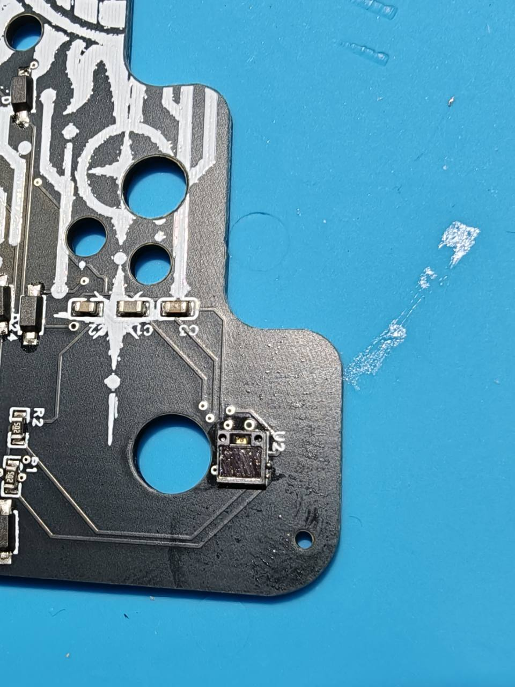

## 2. XIAOと周辺部品を取り付ける

左右それぞれに**Seeed Studio XIAO nRF52840 Plus**を取り付けます。USB端子は基板の外周側を向きます。続いて電源スイッチと昇圧基板を取り付けます。

### XIAOの取り付け

1. XIAOの輪郭とUSB端子の位置を基板に合わせ、各端子が対応するパッドに重なるように置きます。
2. 端の端子を1か所仮止めし、位置ずれや傾きがないか確認します。
3. 位置が決まったら、接続対象の端子を順にはんだ付けします。基板側のパッドとXIAO側の端子の両方にはんだがなじむようにします。
4. 裏面は、接続パッドをはんだ付けします。

### 電源スイッチの取り付け

1. 電源スイッチを基板の穴・パッドに合わせて置き、浮きがない状態で仮止めします。
2. 位置を整え、残りの端子と固定用の端子をはんだ付けします。

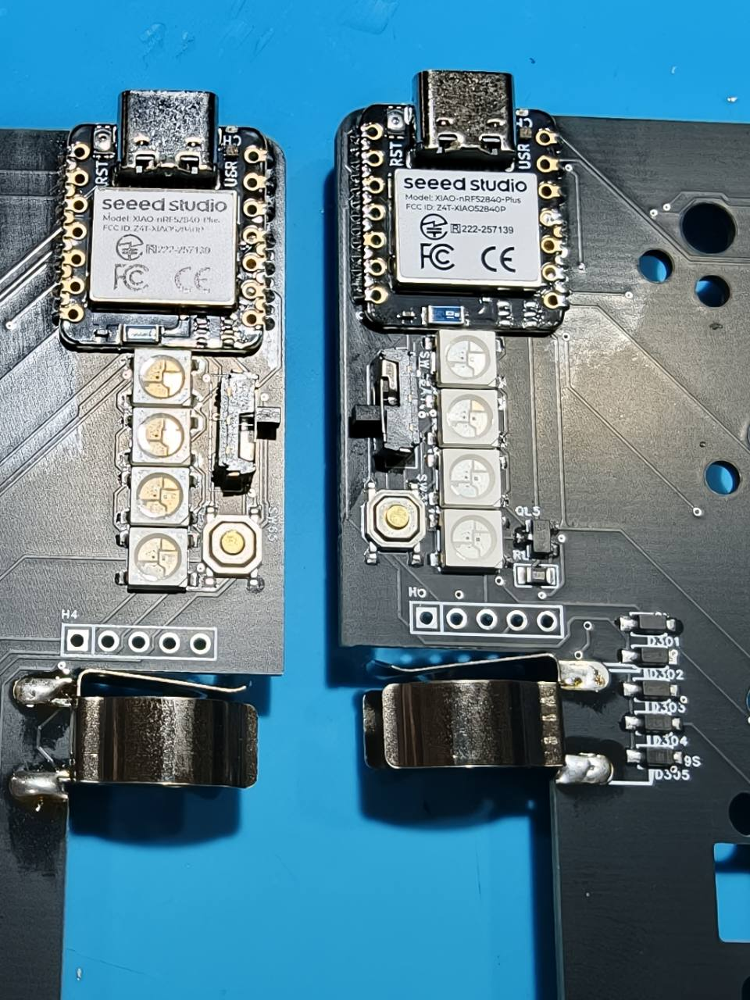

### 昇圧基板の取り付け

裏面の昇圧基板は、**電源スイッチの足を避けるため、写真のように少し斜めに取り付けます。**

1. 昇圧基板の接続端子を取り付け位置に合わせ、電源スイッチの足に当たらないよう、少し斜めに配置します。
2. 端子1か所を仮止めし、写真と照合しながら位置を調整します。
3. 接続端子が対応するパッドに合っていることを確認し、残りをはんだ付けします。

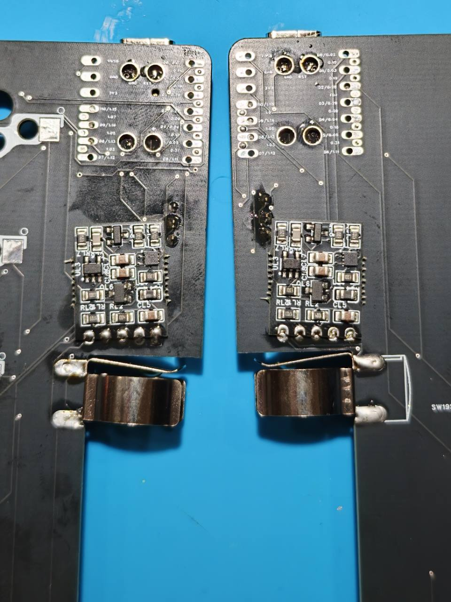

## 3. 電池端子を取り付ける

使用する電池は**単3形乾電池を左右各1本（計2本）**です。電池端子は電池の両端に当たる部品で、左右それぞれに2個取り付けます。極性は基板の表示に合わせてください。ファームウェアの電池残量表示は目安として使ってください。

1. 写真を参考に、基板の内側の切り欠きに沿って端子を配置します。
2. 片側を仮止めし、端子の傾きや浮きを整えます。
3. 残りをはんだ付けし、冷めるまで端子を動かさずに待ちます。

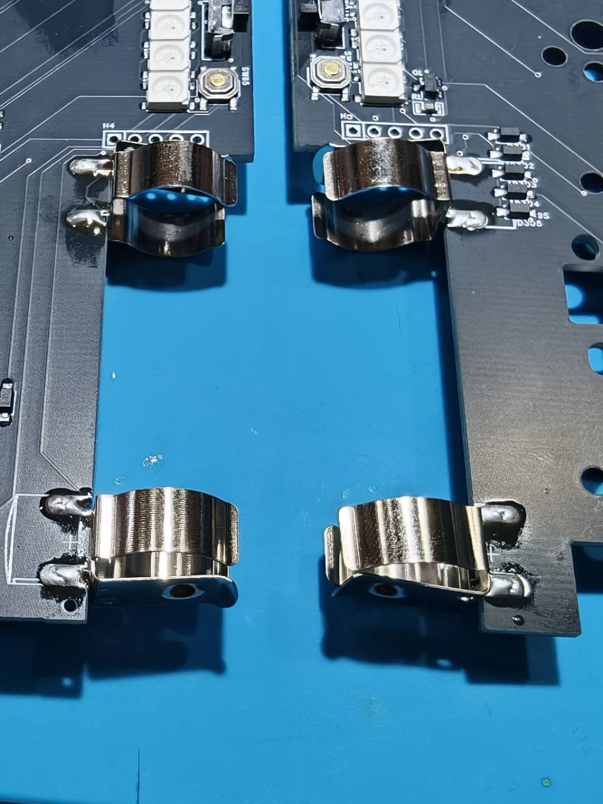

横から見た端子の位置は、下の写真を参考にしてください。

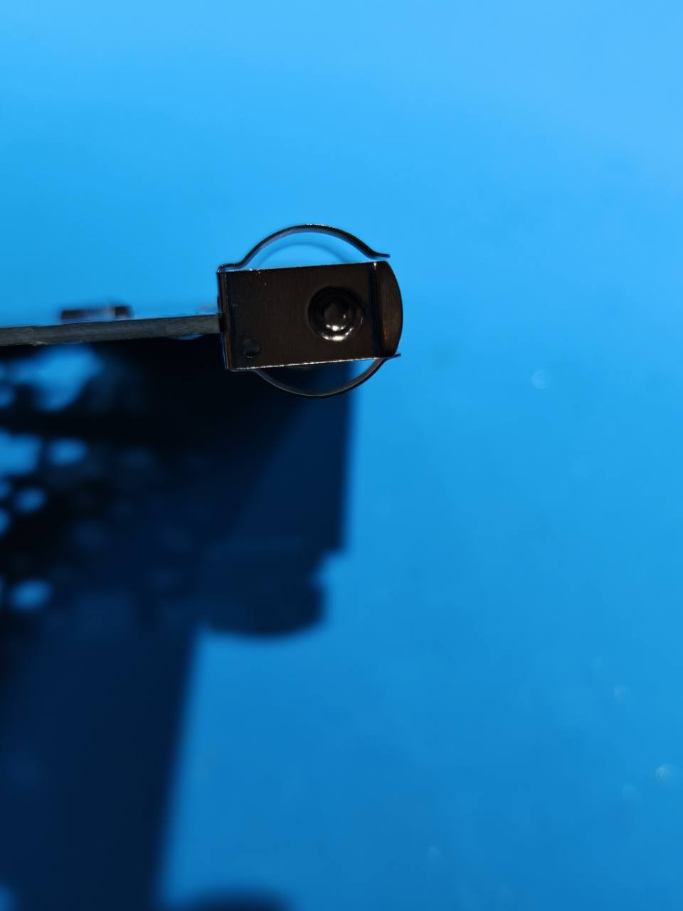

## 4. キースイッチソケットとスタビライザーを取り付ける

### ソケットの取り付け

**使用する配列によって、はんだ付けするソケットの位置が変わります。** 基板の印字・穴位置と写真を見比べ、キーごとに位置と向きを合わせます。

1. ソケットを基板に置き、スイッチのピンが通る穴とソケットの差し込み口を合わせます。
2. 一方の端子を仮止めします。
3. ソケットを基板に密着させ、もう一方をはんだ付けします。
4. 仮止めした側も確認し、浮きやはんだ不足があれば直します。

### センサーモジュールを接続する側

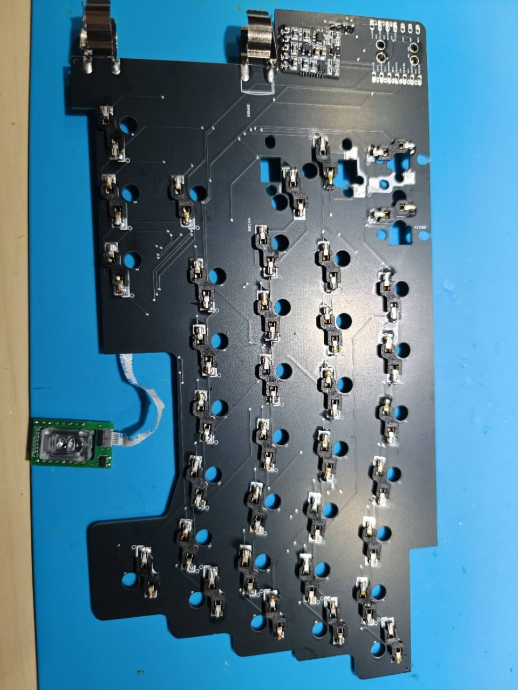

### 反対側

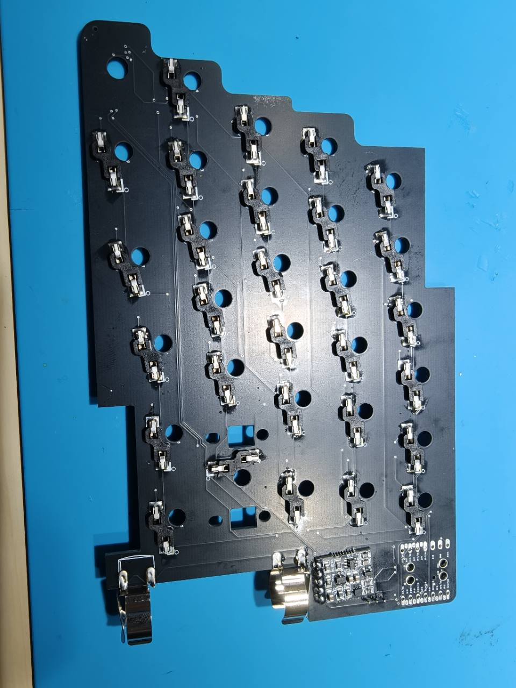

### スタビライザーの取り付け

写真はねじ固定式スタビライザーの取り付け例です。使用する配列に合わせて位置を選びます。

1. スイッチを差し込む面から、スタビライザーの左右のハウジングを基板の取り付け穴に合わせます。
2. 写真のワイヤーの向きに合わせ、ハウジングを基板に収めます。

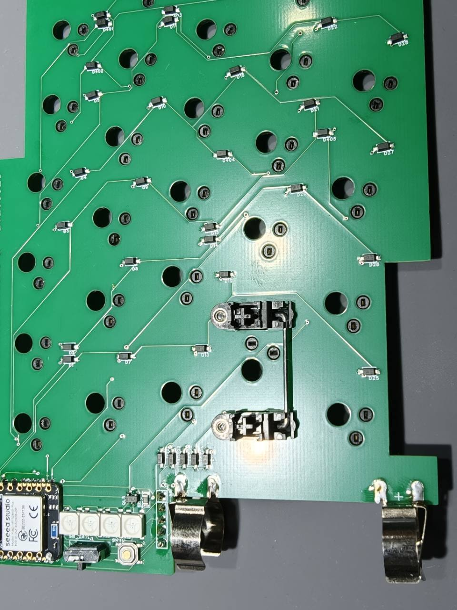

3. 基板を裏返し、左右のハウジングを裏側からねじで固定します。
4. 左右の軸を押して、引っ掛からず上下することを確認します。

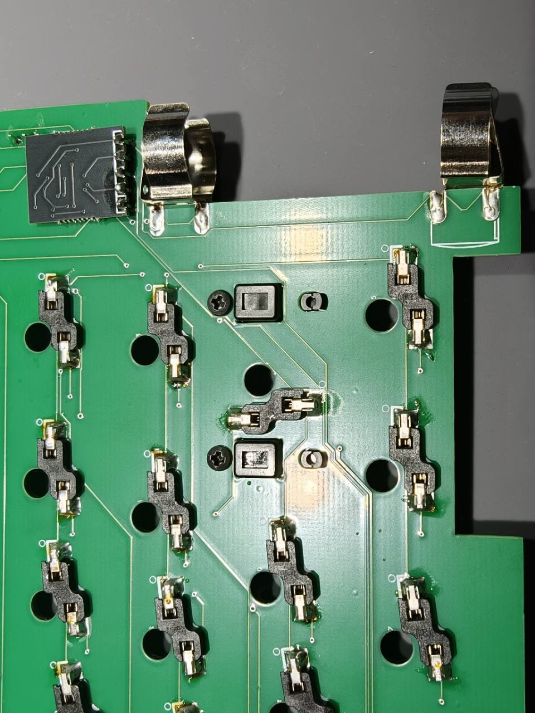

## 5. センサーモジュールを接続する

左右でセンサーの構成が異なります。

|  | 左手 | 右手 |
| --- | --- | --- |
| センサー | PAT9125EL（光学ダイヤル用） | PMW3610（トラックボール用） |
| 取り付け | メインPCBに直接実装済みです。組み立てやはんだ付けは不要です | 完成品の19mmトラックボールモジュール（MeKaBuモジュール）を、FFCケーブルでメインPCBに接続します |
| 役割 | Centralとして、両手の信号をPCへ届けます | Peripheralとして、左手とBLEでつながります |

右手側に接続できるモジュールは、この19mmトラックボールモジュール（PMW3610）のみです。他のMeKaBuモジュールには対応していません。

この節の組み立てと接続の手順は、すべて**右手側のトラックボールモジュール**についてのものです。左手側にセンサーモジュールの組み立てやFFCケーブルの接続はありません。ケース編のノブ（8節）が、左手の光学ダイヤルに対応する操作部品です。

### モジュールの確認（右手側）

トラックボールモジュールは完成品で、別パッケージに入っています。センサー（PMW3610）とFFCコネクタは実装済みで、組み立てやはんだ付けは不要です。開封したら、レンズ面に触れないように基板の縁を持ち、欠けや汚れがないか確認してください。

### FFCケーブルの接続（右手側）

FFCケーブルでメインPCBとセンサーモジュールをつなぎます。ケーブルの接点面をコネクタの接点に向けて差し込みます。

1. コネクタのロック方式を確認します。ロックがある場合は、指定された方向に解除します。
2. ケーブルを斜めにせず、左右均等に奥まで差し込みます。
3. ロックを戻し、ケーブルが片側だけ抜けていないことを確認します。
4. 反対側も同様に接続します。

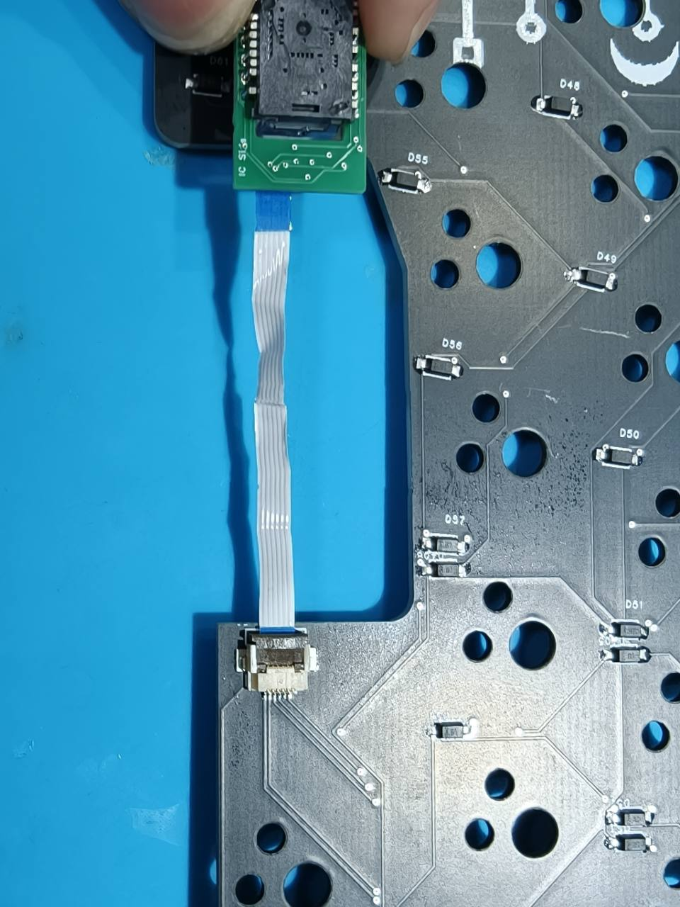

モジュールは基板の縁を持ち、レンズ面には触れないようにします。ケーブルには余裕を持たせます。

モジュールの固定はケース編で行います。FFCケーブルを接続したモジュールを、右手側のモジュール台座に差し込みます。

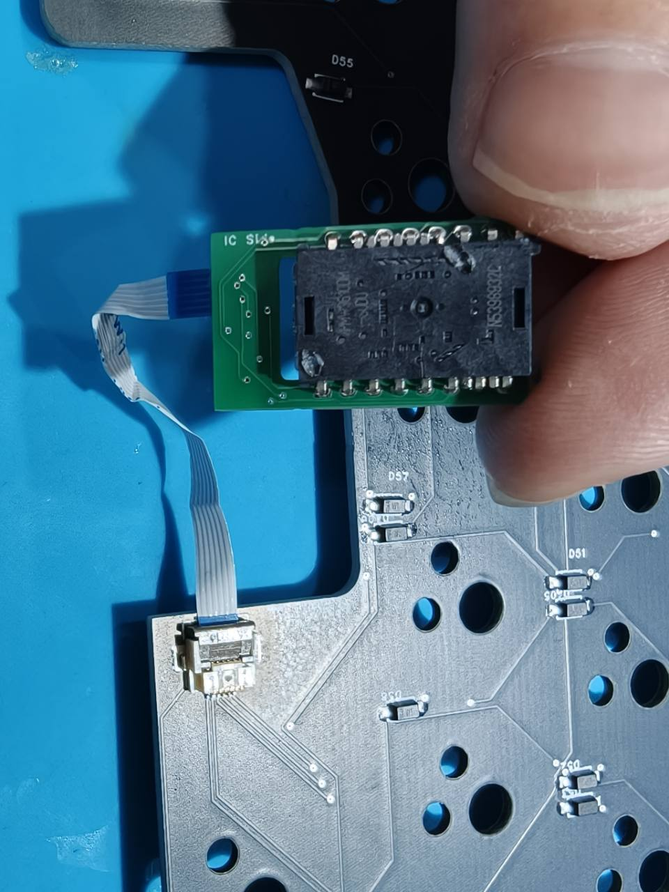

## ケース編の前に：仮通電テスト（必須）

ケースに入れる前に、基板の状態で一度通電して確認します。ここで見つけた不具合は、ケースを閉めた後より直しやすいです。

1. はんだのブリッジや金属くずがないか、もう一度確認します。
2. 末尾の「ファームウェアと動作確認」を参照して、左右それぞれにファームウェアを書き込みます。
3. 左右に電池を入れて電源を入れ、左手（Central）をUSBでPCに接続します。スイッチをソケットに差し込み、左右すべてのキーが反応するか確認します。
4. 左手のダイヤルを回してスクロールすること、右手のトラックボールでカーソルが動くことを確認します。
5. 反応しないキーがある場合は、電源を外してから、そのキーのソケットの浮き・はんだ付けとスイッチのピンを確認します。センサーが反応しない場合は、右手のFFC接続とファームウェアの構成を確認します。

確認できたら、USBと電池の両方を外してケース編へ進みます。

## 6. ケース編：底板にプレートを固定する

使用するねじは **FLA-0305E**、ナットは **M3** です。樹脂部品が変形しない程度に締めます。

1. 底板と刻印があるプレートの穴位置を合わせます。刻印はケースの外側に向けます。
2. 外側からねじを通し、内側に写真の固定部品を配置します。固定部品はプレートの両端に1個ずつ使います。
3. 内側の写真を参考に、各固定部品の3か所へナットを合わせます。すべてを仮止めしてから、位置ずれがないことを確認して少しずつ締めます。

### 底板の外側

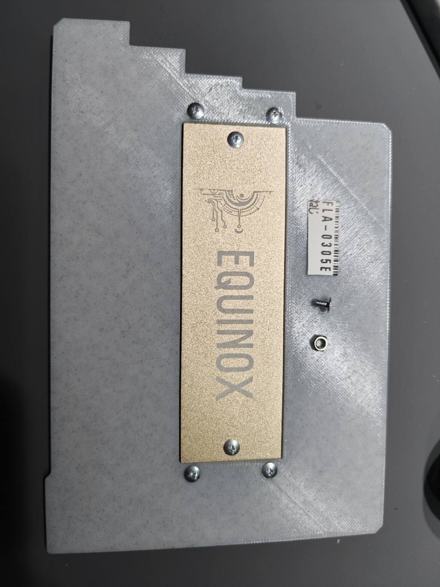

### 底板の内側

黄色い固定部品でプレートの両端を保持します。

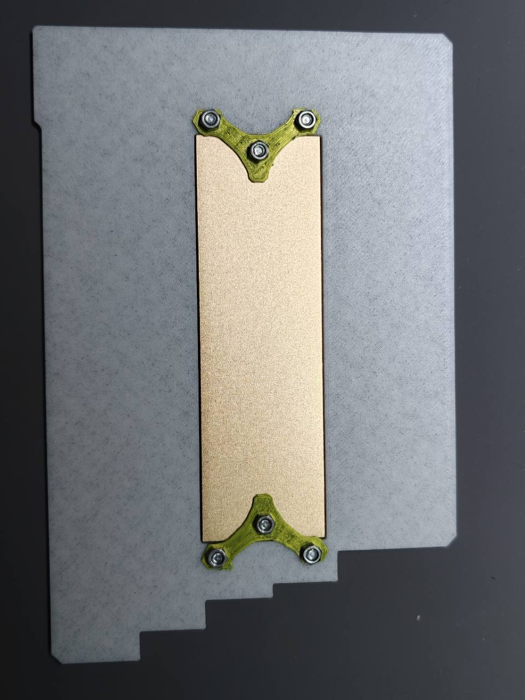

## 7. ケース編：TPUフォームを配置する

1. 底板の内側を上にして、TPUフォームを重ねます。
2. 写真のように外形と切り欠きの向きを合わせ、固定部品との位置関係を確認します。
3. 部材のずれや浮きを整えます。

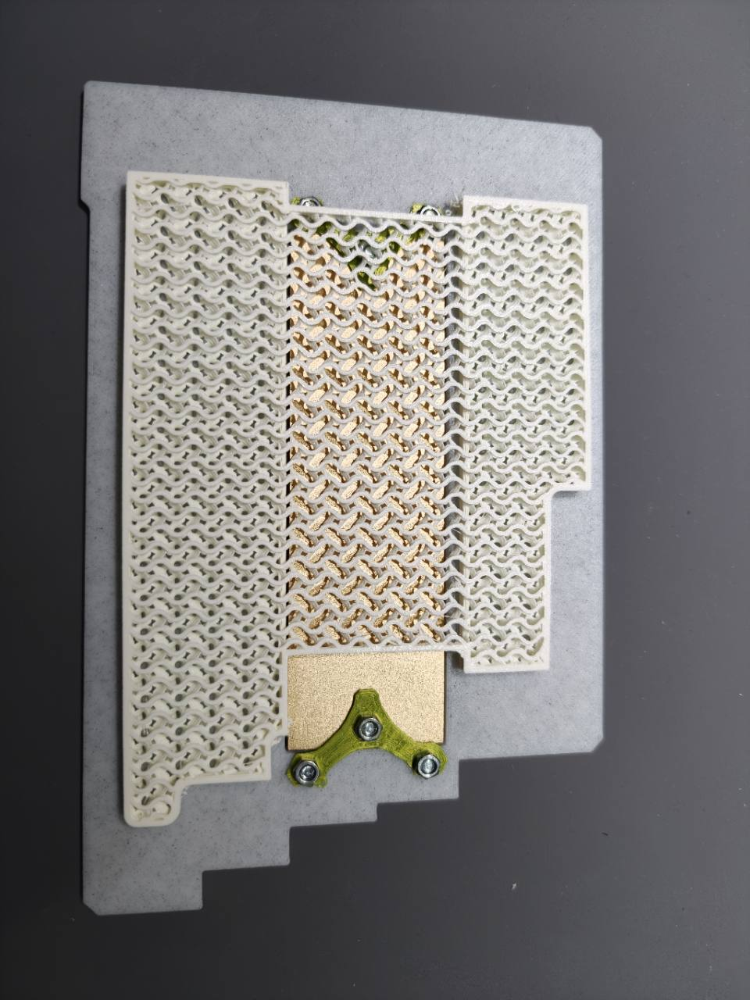

## 8. ケース編：ノブを取り付ける

ノブ本体、四角い取り付け部品、インサートナット、低頭ネジを用意します。

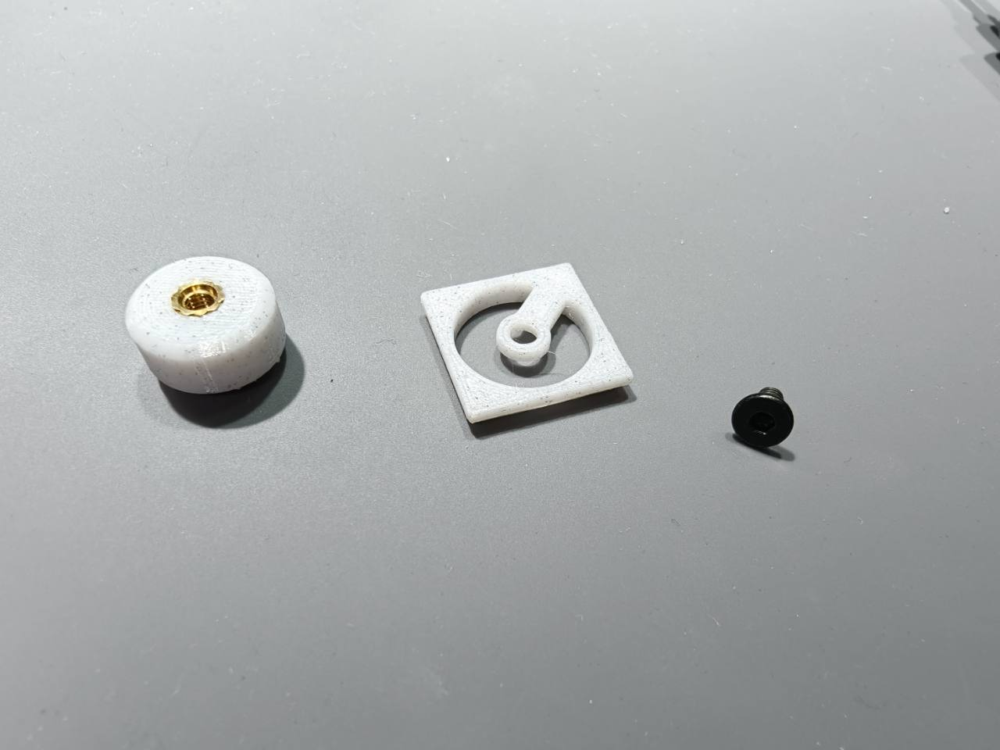

1. ノブ裏面の穴に、はんだごてを使ってインサートナットを熱圧入します。
2. ノブ裏面のねじ穴と取り付け部品の中央の穴を合わせ、取り付け部品の裏側から低頭ネジを通してノブを留めます。

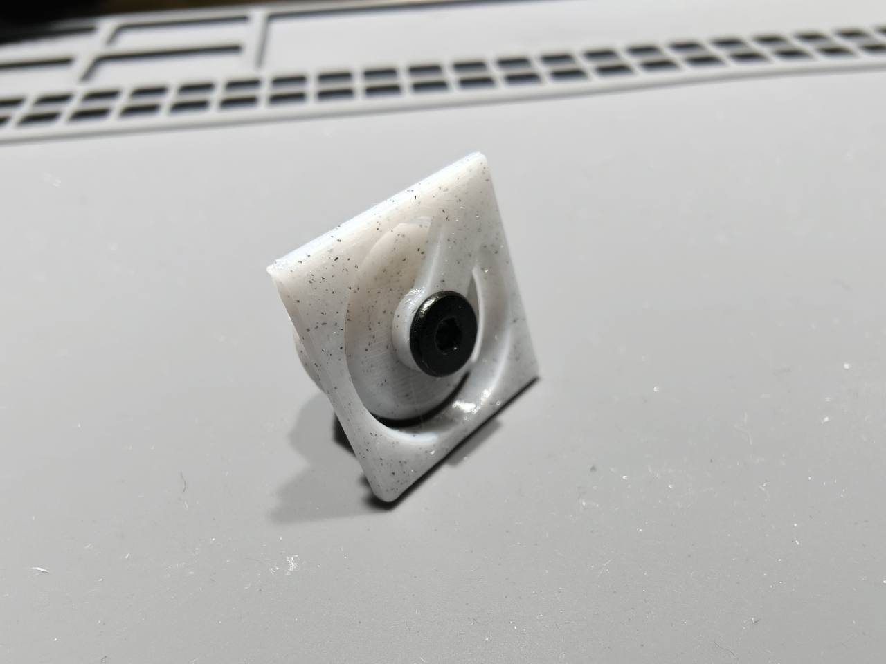

3. 組み立てたノブを、上側ケースの対応する四角い開口部に合わせて取り付けます。
4. 写真のようにノブが表側に出ていることを確認し、指で回して周囲に引っ掛からないか確かめます。

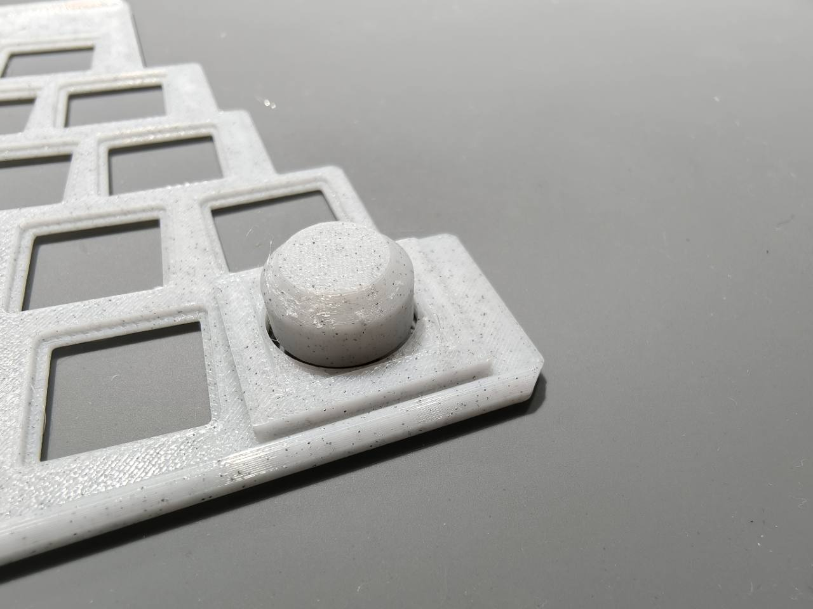

## 9. ケース編：電源スイッチとリセットボタンの操作部品を取り付ける

上側ケースを裏返し、電源スイッチとリセットボタン用の操作部品を取り付けます。

1. 丸形の電源スイッチ用部品と、長方形のリセットボタン用部品を、それぞれの取り付け位置に置きます。
2. 電源スイッチ用部品は、中央の穴を合わせて差し込みます。
3. 基板を合わせ、操作部品の位置と動きを確認します。リセットボタンが押されっぱなしにならないようにします。

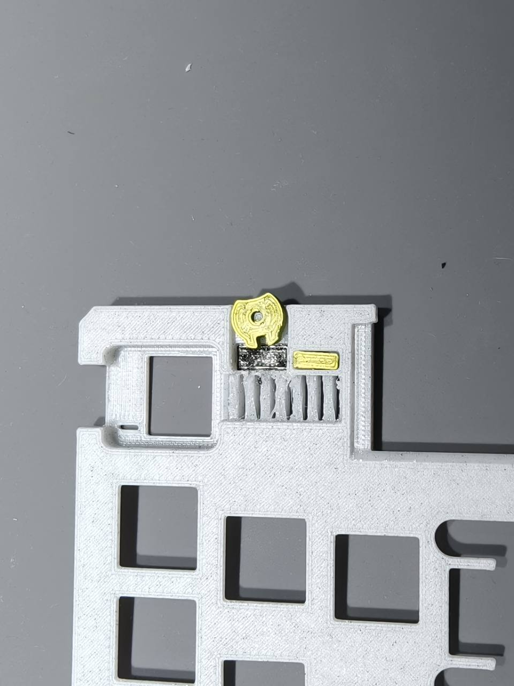

## 10. ケース編：マグネットを取り付ける

**3×6mmのマグネットを片側6個、左右合計12個**使います。**極性の向きは問いません。** 接着剤は白化しないタイプを選びます。

接着剤はこちらがおすすめです（どちらか1つで構いません）：

- [セメダイン スーパーXゴールド クリア（Amazon）](https://link.amazon/B00RwWC7y)
- [B7000 多目的接着剤（Amazon）](https://link.amazon/B04cMQSKp)

1. ケースのマグネット用のくぼみに、少量の接着剤を塗ります。
2. 各くぼみにマグネットを入れ、片側6か所を固定します。
3. 接着剤の指定時間に従って硬化させます。反対側も同様に取り付けます。

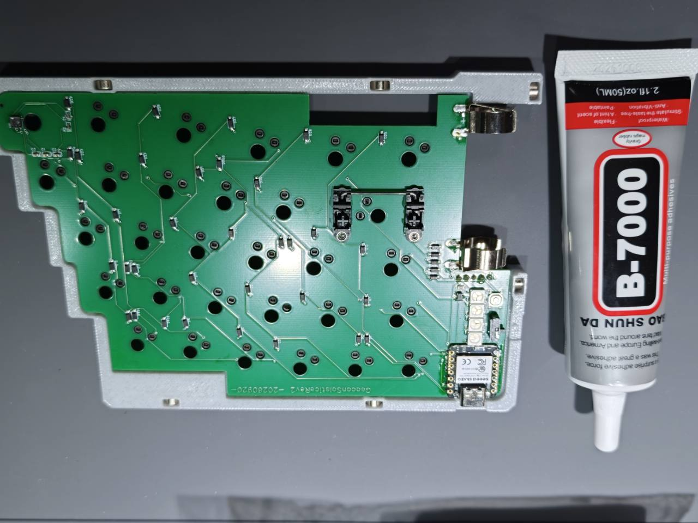

## 11. ケース編：バックルを取り付ける

バックルには **FF-0304E** のねじを使います。

1. バックルの内側から中央の穴へねじを入れます。

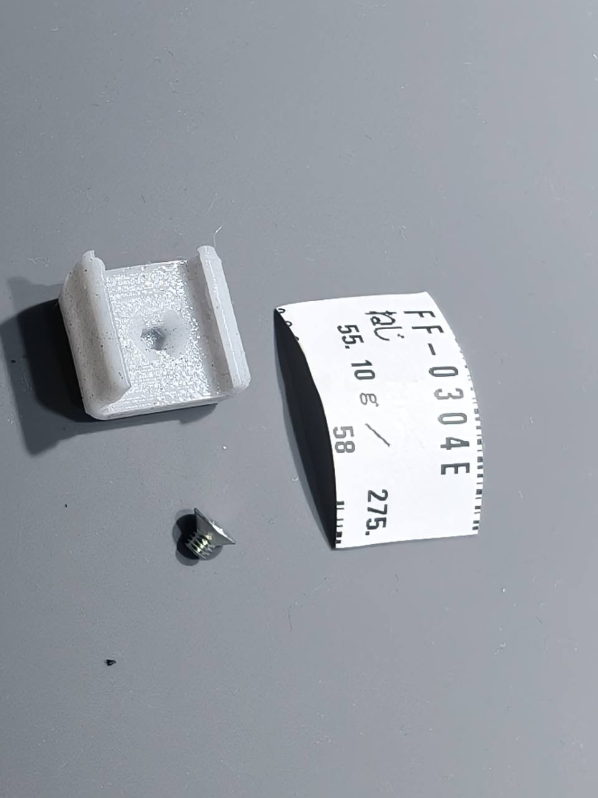

2. ねじ頭を中央のくぼみに収めます。

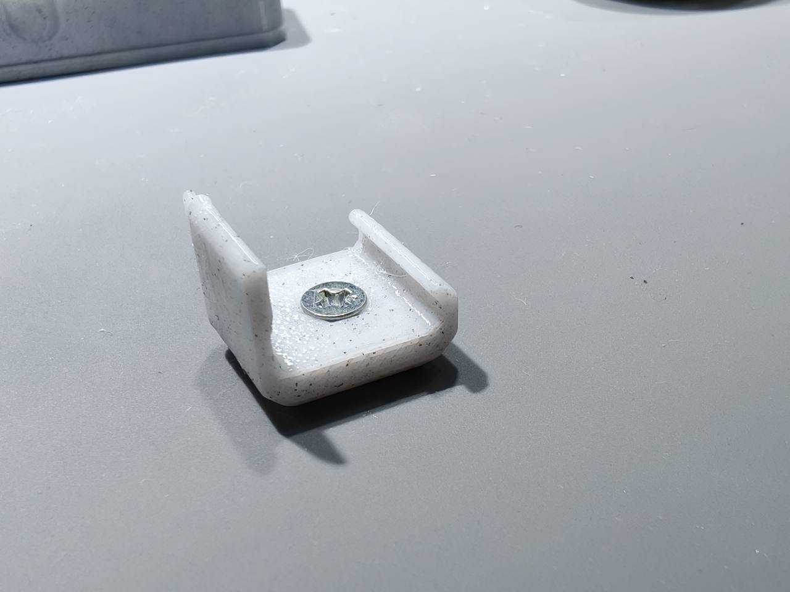

3. 上側ケースと底板の位置を合わせ、下の写真を参考にケース側面へバックルを取り付けます。
4. バックルの縁をケースに掛けます。掛からないときは、無理に広げずケースの位置ずれやケーブルの挟み込みを直します。

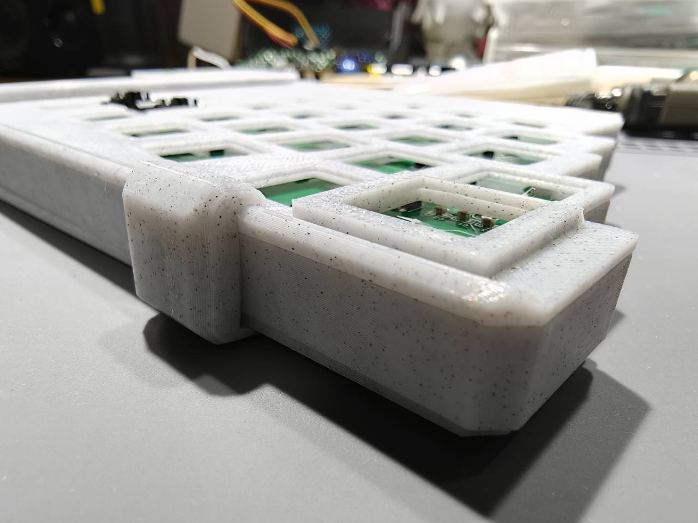

**ケースを閉じるときは、FFCケーブルを縁やねじに挟まないように収めます。**

## 12. ケース編：バッテリーカバーを組み立てる

写真の左が組み立て前、右が組み立て例です。使用するねじの品番は **FLA-0305E** です。

1. スリットのあるカバーのねじ穴側に、細長い部品を重ねます。
2. 両端の穴を合わせ、写真右のようにカバー側からねじを入れて固定します。

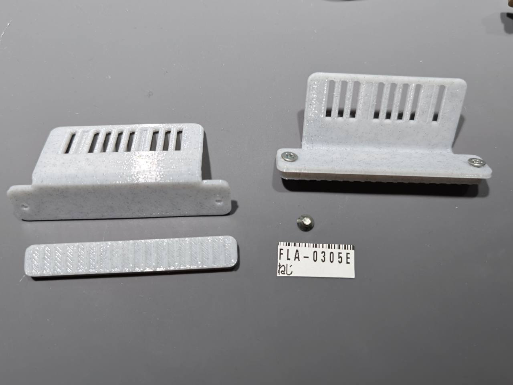

## 13. 通電前のチェック

- はんだのブリッジ、金属くず、部品同士の意図しない接触がない。
- FFCが奥まで入り、ケースに挟まれていない。
- 電源スイッチとリセットボタンが動き、バックルが掛かっている。
- 電池は単3形乾電池を左右各1本ずつ入れ、極性が基板の表示どおりになっている。

通電後に異常な発熱や異臭があれば、USBと電池を外してください。

## ファームウェアと動作確認

ファームウェアは[GeaconEquinoxのリポジトリ](https://github.com/te9no/zmk-keyboard-GeaconEquinox)で配布しています。**左右とも、組み立てた物理配列（US/JIS）に合う組み合わせ**を使ってください。左右で配列を混ぜないでください。

| 物理配列 | 左手（Central） | 右手（Peripheral） |
| --- | --- | --- |
| US | `geacon_equinox_left_us.uf2` | `geacon_equinox_right_us.uf2` |
| JIS | `geacon_equinox_left_jis.uf2` | `geacon_equinox_right_jis.uf2` |

書き込みの基本的な流れ（UF2のコピー方法、書き込み用ドライブの出し方、設定リセットが必要な場合）は[ファームウェアガイド](../90firmwareguide/)を参照してください。通常の書き込みで、設定消去用の `settings_reset` を先に書き込む必要はありません。技術資料と検証状況は、リポジトリの[ファームウェアガイド](https://github.com/te9no/zmk-keyboard-GeaconEquinox/blob/main/docs/firmware.md)にあります。

組み立て後は、左右すべてのキーとセンサーの入力を確認します。無線で使う場合は、PCのBluetooth設定から左手（Central）を選んでペアリングしてください。

- キーが反応しない：電源を外し、スイッチのピン曲がり、ソケットの浮き、はんだ付けを確認します。
- センサーが反応しない：ファームウェアの構成とFFCの接続を確認します。
- 右手だけ反応しない：右手の電源が入っているか、左右に同じ配列のファームウェアを書いたかを確認します。PCと接続するのは左手（Central）です。
