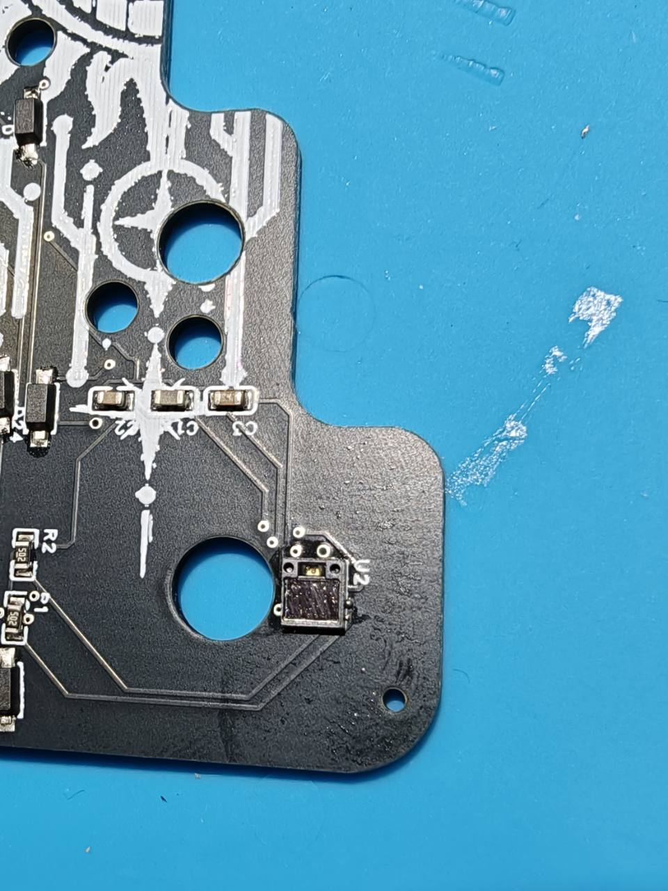
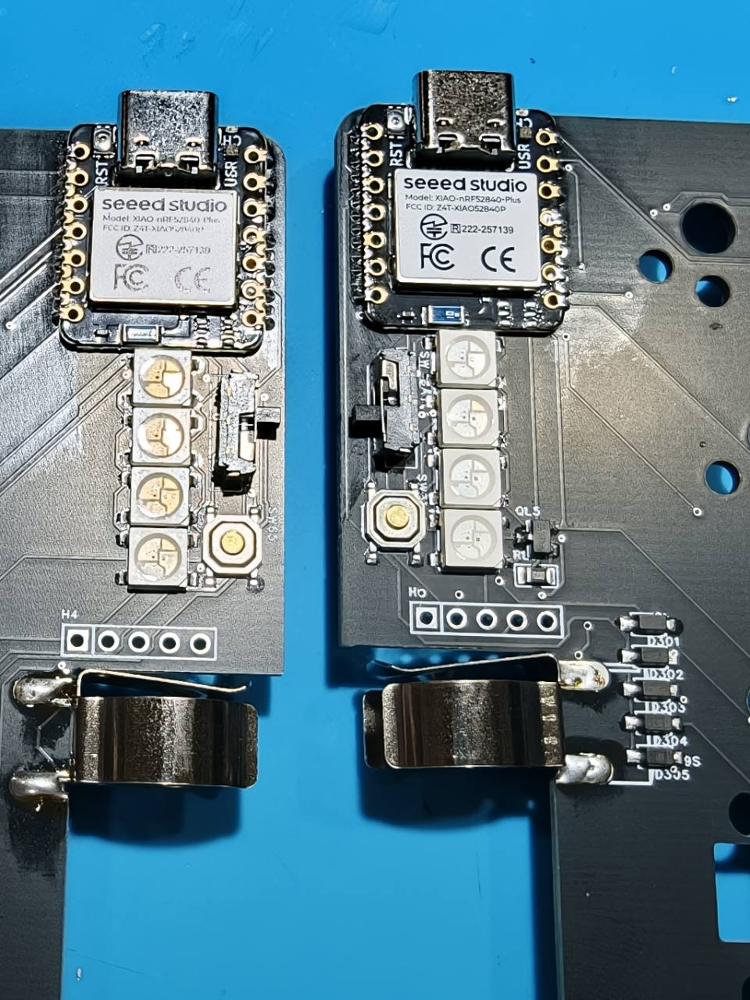
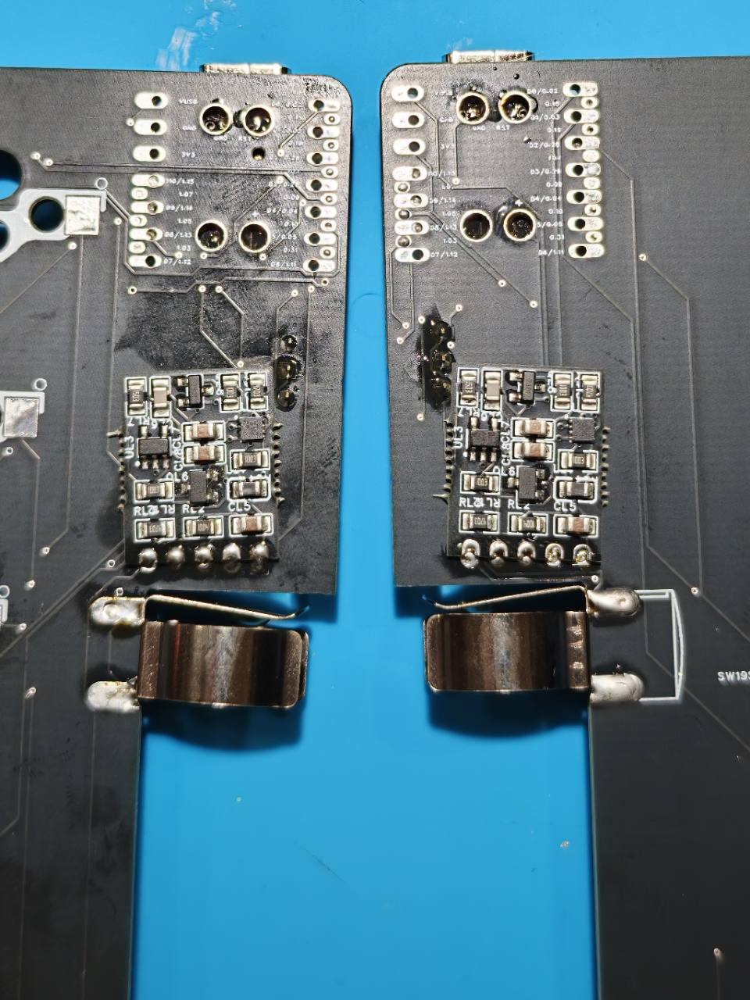
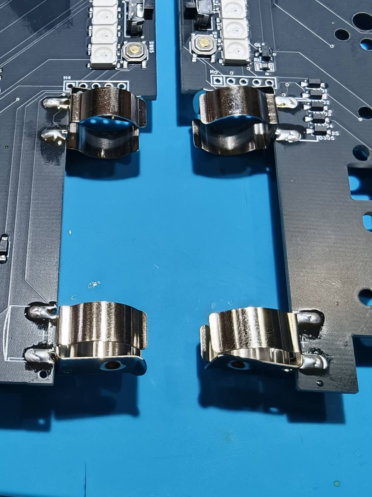
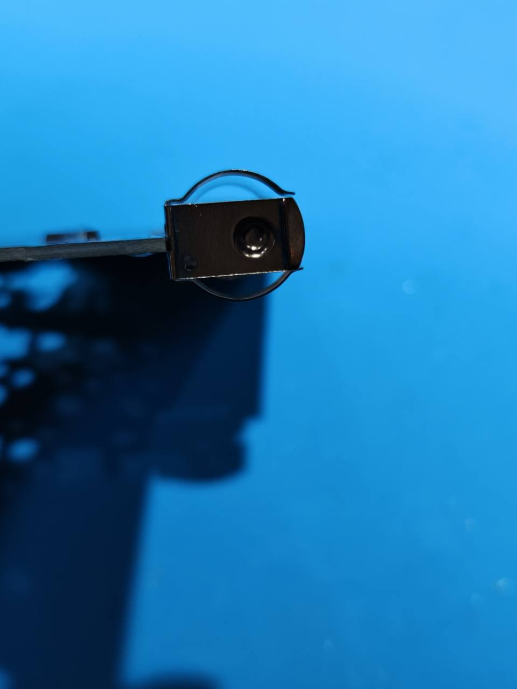
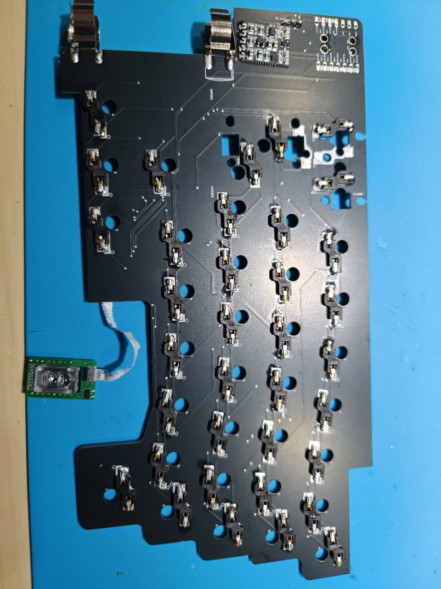
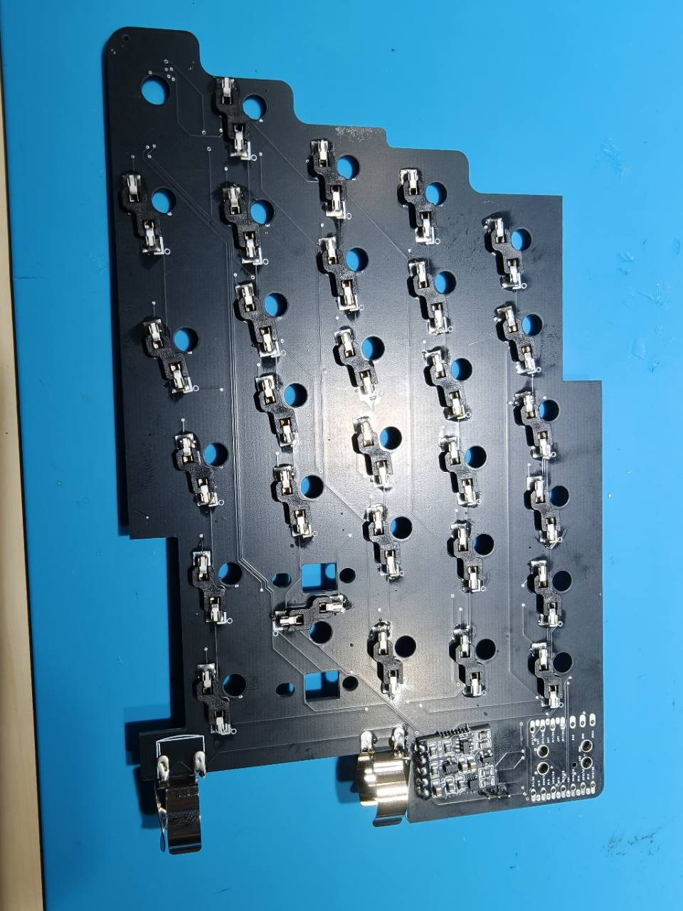
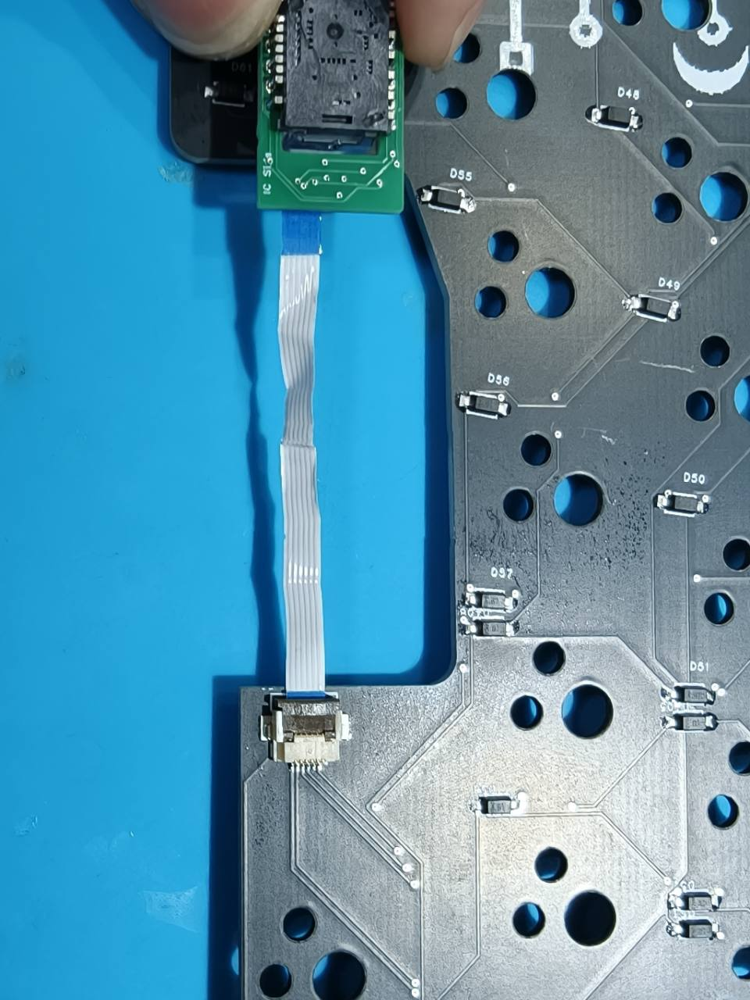
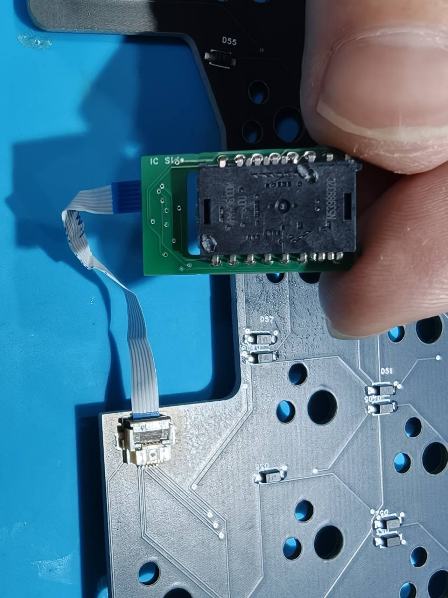

GeaconEquinoxの基板を組み立てるための写真付きガイドです。各部品を自分で取り付ける前提で、位置合わせ、はんだ付け、取り付け後の確認を順番に進めます。写真は各工程の取り付け例です。

本ページは基板の組み立てを中心に案内しています。ケースの固定方法、電池の仕様、対応スイッチ、専用ファームウェアは、お手元のキットの案内と照合してください。旧モデルのGeaconやGeaconSolsticeの仕様を、そのまま流用しないでください。

## 作業を始める前に

- はんだ付けやケーブルの抜き差しは、**USBと電池の両方を外して**行います。
- 基板の版、部品の形状、取り付け位置を確認します。写真と異なる場合は、同梱案内を優先してください。
- 左右を見分けるときは、写真の左右だけでなく、USB端子、基板の切り欠き、部品の印字を目印にします。裏返すと左右の見え方が変わります。
- 電池の種類・電圧・極性が確認できるまでは、電池を入れないでください。端子に収まることだけでは、使用できる電池か判断できません。

はんだごて、はんだ、ピンセット、作業マット、拡大鏡などを用意します。接合部の確認にはテスターもあると便利です。

## 1. 基板の小型部品を取り付ける

写真の構成では、左右のメインPCB、XIAO、電池端子、キースイッチソケット、センサーモジュールとFFCケーブルを使用します。スイッチ、キーキャップ、ケースなどは購入した構成に合わせて用意してください。

まず、基板の小型部品を取り付けます。部品を基板の番号ごとに分け、部品表と照合してください。抵抗やコンデンサの値、ICの向きは、写真の見た目だけで判断しないでください。

1. 基板の部品番号と取り付け面を確認し、対応する部品を用意します。極性や1番ピンのある部品は、部品と基板のマークを合わせます。
2. 取り付け位置のパッド1か所に少量の予備はんだを載せます。
3. ピンセットで部品を置き、予備はんだを溶かして仮止めします。
4. 位置と向きを確認し、残りの端子をはんだ付けします。多ピン部品は各端子が対応するパッドに合っていることを確認してから進めます。
5. 拡大して、浮き、はんだ不足、隣の端子とのブリッジがないか確認します。

下の写真は、基板端のU2と周辺部品を取り付けた例です。端子以外の面や開口部へ、はんだやフラックスを付着させないようにしてください。

## 2. XIAOと周辺部品を取り付ける

左右それぞれに**Seeed Studio XIAO nRF52840 Plus**を取り付けます。USB端子は基板の外周側を向きます。近くのLEDとスイッチ類も、この工程で取り付けます。

### XIAOの取り付け

1. XIAOの輪郭とUSB端子の位置を基板に合わせ、各端子が対応するパッドに重なるように置きます。
2. 端の端子を1か所仮止めし、位置ずれや傾きがないか確認します。
3. 位置が決まったら、接続対象の端子を順にはんだ付けします。基板側のパッドとXIAO側の端子の両方にはんだがなじむようにします。
4. 裏面の接続箇所も作業します。接続するパッドと取り付け方法は同梱案内で確認し、写真に見える穴をすべてはんだで埋めないでください。

### LED・スイッチ類の取り付け

1. LEDの向き・極性を部品と基板のマークで合わせます。左右で写真上の向きが変わるため、それぞれの基板で確認します。
2. 端子1か所を仮止めし、LEDが傾いていないことを確認してから残りをはんだ付けします。
3. スイッチ類を基板の穴・パッドに合わせて置き、浮きがない状態で仮止めします。
4. 位置を整え、残りの端子と固定用の端子をはんだ付けします。可動部へはんだを流さないでください。

裏面の部品も、基板の番号と向きを合わせて取り付けます。下の写真を取り付け位置の参考にし、片側を仮止めしてから残りの端子をはんだ付けしてください。別基板になっている部分は接続端子の位置を合わせ、傾きや浮きがないことを確認して固定します。

取り付け後は表裏を確認し、隣接するパッド間に意図しないはんだのつながりがないかを見てください。

## 3. 電池端子を取り付ける

1. 基板の極性表示と同梱案内を確認し、端子を取り付け位置に合わせます。電池はまだ入れません。
2. 写真を参考に、基板の内側の切り欠きに沿って端子を配置します。
3. 片側の接合部を仮止めし、端子が傾いたり、浮いたりしていないか確認します。
4. 位置を整えてから残りをはんだ付けします。はんだが十分に冷めるまで端子を動かさないでください。

横から見て、端子の高さと傾きを確認します。基板の縁に対する位置は、下の写真を参考にしてください。電池の保持部分へはんだを流したり、端子を無理に曲げたりしないでください。

**確認ポイント：** 端子がぐらつかないこと、周囲の部品やパッドと接触していないこと、極性表示を見失っていないことを確認します。

## 4. キースイッチソケットを取り付ける

ソケットの取り付け面と向きを、基板の印字・穴位置・以下の全体写真で確認します。キー位置によって向きが異なるため、すべて同じ向きに並べないでください。

1. ソケットを基板に置き、スイッチのピンが通る穴とソケットの差し込み口を合わせます。
2. 一方の端子を仮止めします。
3. ソケットが基板に密着していることを確認し、もう一方をはんだ付けします。
4. 仮止めした側も確認し、未接合や浮きがあれば直します。

### センサーモジュールを接続する側

### 反対側

スイッチを差し込む前に、すべてのソケットの接合部を確認します。差し込み時はスイッチのピンが曲がっていないことを確認し、ソケット側を支えながらまっすぐ入れます。強く押して基板からソケットを剥がさないよう注意してください。

## 5. センサーモジュールを組み立てて接続する

USBと電池が外れていることを、もう一度確認します。

### センサーとコネクタの取り付け

1. センサーをモジュール基板の印字と端子位置に合わせて置きます。向きは部品のマークと基板の表示で確認してください。
2. 端子1か所を仮止めし、位置と傾きを整えてから残りをはんだ付けします。隣り合う端子をはんだでつながないようにします。
3. FFCコネクタを対応するパッドに合わせ、ケーブルの差し込み口の向きを確認して取り付けます。固定用の端子で位置を決めてから、信号端子をはんだ付けします。メインPCB側も同様に作業します。
4. 接合部を拡大して確認します。コネクタの樹脂やロック部分にこて先を当てず、差し込み口にはんだを流さないでください。

### FFCケーブルの接続

FFCケーブルは、メインPCBとセンサーモジュールのコネクタをつなぎます。ケーブルの接点面とコネクタの接点が向かい合うことを確認してください。**青い補強板の色だけで、差し込む向きを判断しないでください。**

1. コネクタのロック方式を確認します。ロックがある場合は、指定された方向に解除します。
2. ケーブルを斜めにせず、左右均等に奥まで差し込みます。
3. ロックを戻し、ケーブルが片側だけ抜けていないことを確認します。
4. 反対側も同様に接続します。ケーブルを強く引っ張って確認しないでください。

モジュールは基板の縁を持ち、センサーの開口部やレンズ面に触れないようにします。ケーブルに余裕を持たせ、鋭く折ったり、ケースやねじで挟んだりしないように配置してください。写真は接続の確認用で、ケース内の固定位置を示すものではありません。

## 6. 通電前のチェック

- ソケットや電池端子に浮き・ぐらつきがない。
- 隣のパッドへはんだがつながっていない。
- 基板に、はんだくずや金属片が残っていない。
- FFCがまっすぐ差し込まれ、ロックが閉じている。
- 金属端子やセンサーモジュールが、意図しない場所で基板に接触していない。
- 使用する電池の種類・電圧・極性を、キットの案内で確認できている。

通電して発熱、異臭などがあった場合は、すぐに使用を中止してUSBと電池を外します。原因が分からないまま再通電しないでください。

## ファームウェアと動作確認

**GeaconEquinoxの基板と構成に対応したファームウェア**を使用してください。GeaconPolarisやGeaconSolsticeなど、別モデルのファイルでは代用できません。配布ファイルの対象機種・左右・モジュール構成が確認できない場合は、頒布元へ確認してください。

書き込みの基本的な流れは[ファームウェアガイド](../90firmwareguide/)を参照してください。起動操作やファイル名は、GeaconEquinoxの配布案内を優先します。

動作確認では、すべてのキーを1つずつ押し、左右それぞれの入力を確認します。センサーは使用するケース・保持部品に正しく固定してから確認してください。反応しないキーがある場合は電源を外し、スイッチのピン曲がり、ソケットの浮き、はんだ付けを見直します。センサーが反応しない場合は、対応ファームウェアとFFCの接続を確認します。
