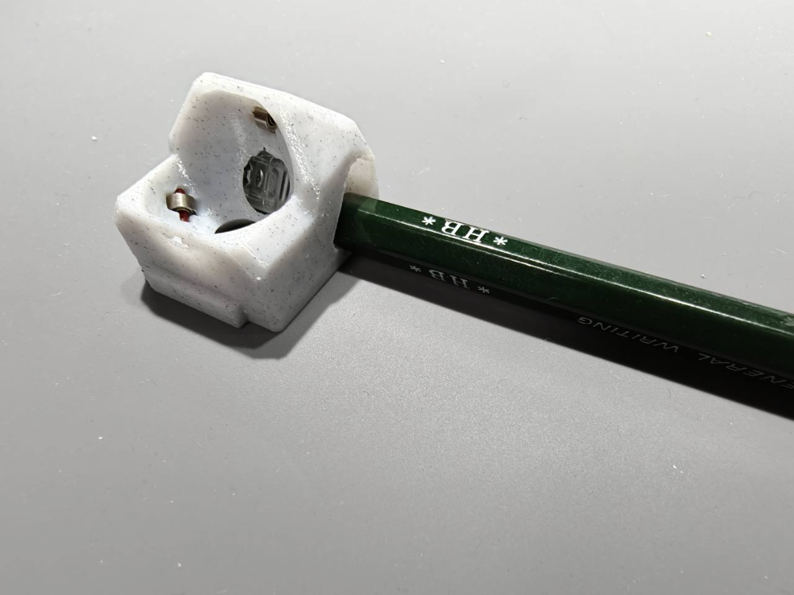
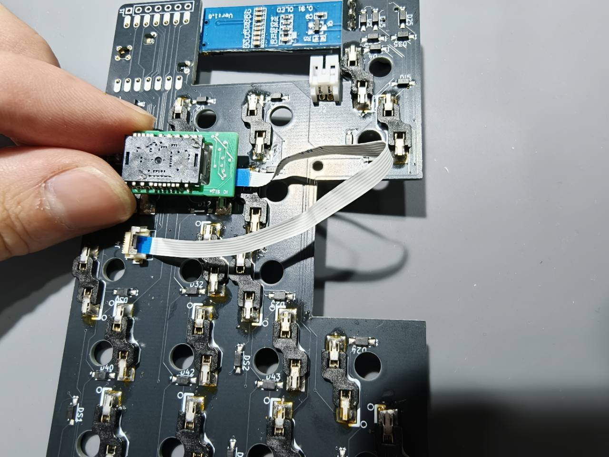

## 1. ハウジングからセンサーを外す

鉛筆など、センサーを押し出すための道具を用意します。**ハウジング（白いケース）は折れやすいので、鉛筆をてこのように使ってこじらないでください。**

1. ハウジングを手で支え、写真のように側面から鉛筆を当てます。
2. センサーをゆっくり押し出します。ハウジングがたわんだり、センサーが動かなかったりしたら、いったん力を抜いて鉛筆を当てる位置を確認してください。

## 2. フラットケーブルを接続する

USBケーブルと電池を外してから、白いフラットケーブルでセンサー基板とキーボード基板をつなぎます。**ケーブル両端の青色タブの向き**を、それぞれの基板を目印に合わせてください。

1. **センサー側（写真左上の緑の基板）：** 金属カバーが見える面を手前にします。その面から青色タブが見える向きで、ケーブルをまっすぐ差し込みます。
2. **キーボード側（写真左下の白いコネクタ）：** キースイッチソケットが見える面を手前にします。その面から青色タブが見える向きで、もう一端を差し込みます。
3. 通電前に、両端ともケーブルが斜めに入っていないことを確認します。
